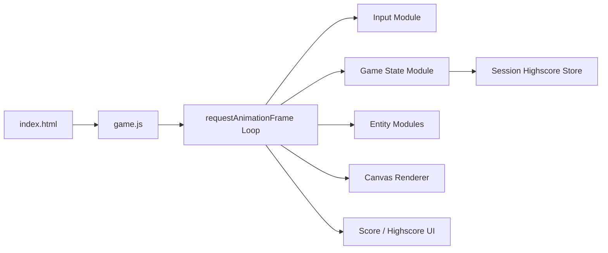

# ARC-001 Overall Architectural Pattern

## Context

The Alien Invasion game is a client-side web application running entirely in the browser. All gameplay logic, rendering, input handling, and state management execute on the client. No server component exists. The system must support the core gameplay loop: alien formation movement, player ship control, projectile firing and collision, score tracking, game-over detection, and session highscore management — all within a single HTML page loading a JavaScript module.

## Decision

The architecture follows a **simple module-based game loop** pattern with these characteristics:

- **Single HTML entry point** (`index.html`) loads one JavaScript module (`game.js`).
- **RequestAnimationFrame-driven loop** advances simulation and rendering each frame.
- **Flat module structure**: one file per concern (input, rendering, game state, entities, highscore), no layering, no dependency injection, no framework.
- **In-memory state only**: all game data lives in JavaScript objects; no persistence across page reloads.
- **No build step**: plain ES modules run directly in the browser.

The loop order each frame:
1. Read input state
2. Update game state (movement, collisions, spawn/despawn)
3. Check game-over conditions
4. Render to canvas
5. Update UI (score display)

## Alternatives

- **Layered architecture** (UI / Game Engine / Platform) — rejected: adds files and indirection without a second platform or team; violates YAGNI NO UNNECESSARY ABSTRACTION.
- **Entity-Component-System (ECS)** — rejected: introduces abstraction (components, systems, entities) not required by any use case; violates KISS NO EXTRA FEATURES and YAGNI.
- **Game engine library (Phaser, PixiJS)** — rejected: adds external dependency, bundle size, and learning curve for features the SPEC does not require; violates YAGNI.
- **WebWorker for simulation** — rejected: no performance need identified; adds complexity (message passing, state sync) without a forcing requirement.

## Consequences

- **Positive**: minimal file count, zero dependencies, immediate browser execution, trivial debugging, each module maps to one SPEC requirement cluster.
- **Negative**: no hot-reload, no TypeScript, no automated refactoring across modules — accepted because the codebase stays small (< 10 files).
- **Testability**: pure functions in modules can be unit-tested via Node with JSDOM; integration tests drive the real `index.html` in Playwright.
- **Extensibility**: new features require new modules or edits to existing ones; no plugin system — consistent with YAGNI.

