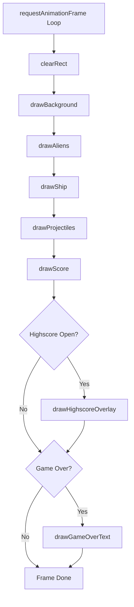

# ARC-002 Rendering via HTML5 Canvas

## Context

The game requires real-time rendering of a player ship, alien formation, projectiles, and UI elements (score, highscore overlay) at 60 FPS. All rendering is 2D. No 3D, WebGL, or CSS animation is required. The SPEC mandates a client-side web app with Canvas rendering.

## Decision

Rendering uses a **single HTML5 `<canvas>` element** with a 2D drawing context (`CanvasRenderingContext2D`).

- **Canvas sizing**: fixed logical resolution (e.g., 800×600) scaled via CSS to fill viewport while preserving aspect ratio; `devicePixelRatio` handled for crisp rendering on high-DPI displays.
- **Clear each frame**: `ctx.clearRect(0, 0, width, height)` at frame start.
- **Draw order** (back to front):
  1. Background (black)
  2. Alien formation (rows of rectangles/sprites)
  3. Player ship (rectangle/triangle at bottom center)
  4. Projectiles (small rectangles moving upward)
  5. Score text (top-left, `fillText`)
  6. Highscore overlay (when open, semi-transparent panel with list)
  7. Game-over text (centered, large)
- **No retained scene graph**: each frame recomputes draw calls from current game state — simple, no invalidation logic needed.
- **No external assets**: all graphics are procedural (rectangles, `fillRect`, `fillText`); no image loading, no sprite sheets.

## Alternatives

- **DOM/CSS rendering** (divs for entities) — rejected: poor performance for dozens of moving objects; layout thrashing; violates KISS for a game loop.
- **WebGL / Three.js / PixiJS** — rejected: overkill for 2D rectangles and text; adds dependency and bundle size; violates YAGNI.
- **SVG** — rejected: DOM overhead per entity; not designed for high-frame-rate animation.
- **OffscreenCanvas + WebWorker** — rejected: no performance requirement forcing multi-threaded rendering; adds complexity.

## Consequences

- **Positive**: zero dependencies, universal browser support, trivial to debug (canvas is a bitmap), deterministic frame output.
- **Negative**: manual text layout (no auto-wrap), no hit-testing from browser (collision done in game logic), no accessibility tree for game entities — accepted; score/highscore are separate DOM elements for accessibility.
- **Testability**: renderer is a pure function `render(ctx, state)` — unit-testable with a mock `CanvasRenderingContext2D` or via pixel-diff in integration tests.
- **Extensibility**: adding a new entity type means one more `drawX(ctx, entity)` function; no architectural change.

