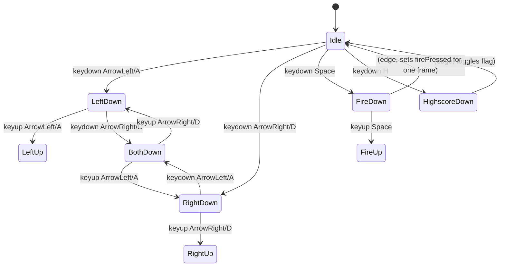

# ARC-003 Input via Keyboard Event Listeners

## Context

The player controls the ship with Arrow-Left/Right or A/D (horizontal movement) and fires with Spacebar. During gameplay, pressing 'H' toggles the highscore overlay. All input is discrete key events; no mouse, touch, or gamepad support is required.

## Decision

Input is captured by **global `keydown` / `keyup` listeners on `window`** feeding a tiny **input state object**:

```js
const input = {
  left: false,
  right: false,
  fire: false,
  firePressed: false,  // true only on the frame Spacebar goes down
  highscoreToggle: false
};
```

- `keydown` sets the corresponding flag; `keyup` clears it.
- Spacebar uses an edge detector: `firePressed` is true for exactly one frame after the key goes down, then cleared until release + press again — implements "only one projectile per key press" (UC-001 Main flow: projectile created on Spacebar press).
- Simultaneous left+right sets both flags true; the movement module treats this as "inputs cancel" (UC-001 Alternative flow A1).
- 'H' key toggles `highscoreToggle` on keydown (edge-triggered like fire).
- No `preventDefault()` on arrow keys (page scroll is acceptable); Spacebar gets `preventDefault()` to avoid page scroll.
- Listeners attached once at startup; removed on page unload (not strictly needed but clean).

## Alternatives

- **`requestAnimationFrame` polling of `KeyboardEvent.getModifierState`** — rejected: no such API for arbitrary keys; would require a polyfill.
- **Gamepad API** — rejected: no requirement for gamepad support.
- **Pointer Lock / Mouse Lock** — rejected: no mouse control in SPEC.
- **Input library (e.g., `keyboard.js`)** — rejected: adds dependency for ~30 lines of vanilla code; violates YAGNI.

## Consequences

- **Positive**: zero dependencies, trivial to test (dispatch `KeyboardEvent` on `window`), matches browser event model exactly.
- **Negative**: no input remapping, no touch fallback — accepted because SPEC does not require them.
- **Testability**: unit tests inject `KeyboardEvent` via `window.dispatchEvent` and assert `input` object state.
- **Accessibility**: all actions keyboard-only; no simultaneous key chords beyond left+right (which cancels).

