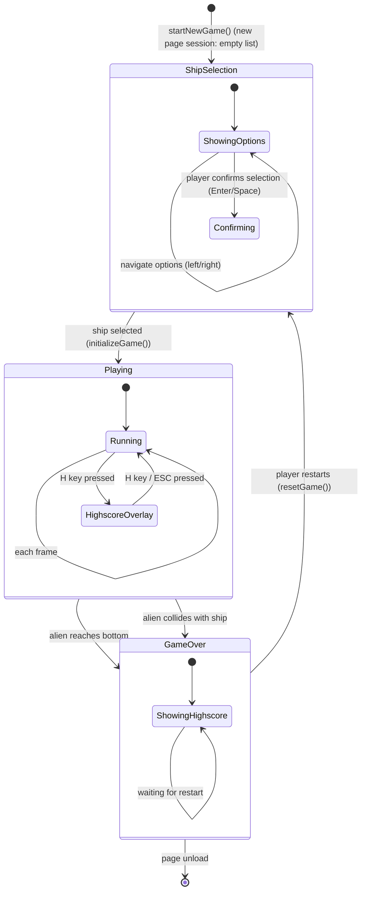

# ARC-004 Game State Machine

## Context

The game has three primary states: **ShipSelection**, **Playing**, and **GameOver**. Transitions are triggered by ship selection, game-over conditions (alien reaches bottom, alien collides with ship), and by the player starting a new session. The state machine controls which systems run each frame and which UI is visible.

## Decision

A **simple three-state machine** implemented as a string variable `gameState` with values `'shipselection'` | `'playing'` | `'gameover'`.

- **ShipSelection state**:
  - Game loop renders the ship selection screen showing all available ship types
  - Player chooses between available ship types (regular or slow) using left/right navigation
  - Regular ship option shows: standard speed, standard projectile
  - Slow ship option shows: slower horizontal movement, special projectile destroying up to three aliens per shot
  - Player confirms selection (Enter/Space); `initializeGame(selectedShipType)` called which:
    - Sets up alien formation and ship position with the chosen ship type (regular or slow)
    - Configures ship movement speed and projectile behavior per type
    - Sets `gameState = 'playing'`
  - No game entities (aliens, projectiles) are active
  - Input only accepts ship selection navigation (left/right) and confirmation
  - Highscore overlay is not accessible

- **Playing state**:
  - Game loop runs: input → update → collision → render
  - Alien formation moves and descends
  - Player ship responds to input with type-specific movement speed
  - Projectiles fire and move with type-specific behavior (regular: single alien; slow: up to three aliens)
  - Collision detection active
  - Score increments on alien destruction
  - Highscore overlay accessible via 'H' key

- **GameOver state**:
  - Game loop stops updating entities (no movement, no spawning)
  - Render shows final frame + game-over text + highscore list
  - Input only accepts new-session trigger (e.g., Enter/Space to restart)
  - Session highscore list displayed automatically

- **Transition ShipSelection → Playing**: when player confirms a ship selection; `initializeGame(selectedShipType)` called which:
  - Sets up alien formation and ship position with the chosen ship type
  - Configures ship movement speed and projectile behavior per type
  - Sets `gameState = 'playing'`

- **Transition Playing → GameOver**: when any alien's y-position ≥ ship y-position OR alien bounding box intersects ship bounding box (UC-004).

- **Transition GameOver → ShipSelection**: player presses restart key; `startNewGame()` called which:
  - Clears all entities
  - Resets score to 0
  - Keeps the session highscore list: the session is the page's session (it
    starts when the page is loaded), so a restart starts a new game in the
    same session and keeps the list. SESSION HIGHSCORE RESET resets the list
    only on a new page session (UC-006).
  - Sets phase to 'ShipSelection' (new game in the same session)

No pause state, no menu state, no level transition — YAGNI.

## Alternatives

- **Explicit state class hierarchy** (`ShipSelectionState`, `PlayingState`, `GameOverState` with `enter()`, `update()`, `exit()`) — rejected: adds files and boilerplate for three states; violates YAGNI.
- **State machine library (e.g., `xstate`)** — rejected: external dependency for a 3-state machine; violates YAGNI.
- **Enum-like object with sub-states** (e.g., `playing: { wave: 1 }`) — rejected: no wave/level concept in SPEC.

## Consequences

- **Positive**: trivial to understand, zero dependencies, state checks are `if (gameState === 'playing')` — readable and fast.
- **Negative**: no hierarchical states, no entry/exit hooks — accepted; not needed.
- **Testability**: state transitions are pure functions `nextState(currentState, event)` — unit-testable without browser.
- **Extensibility**: adding a pause state would mean one more string value and one `if` branch; no structural change.

