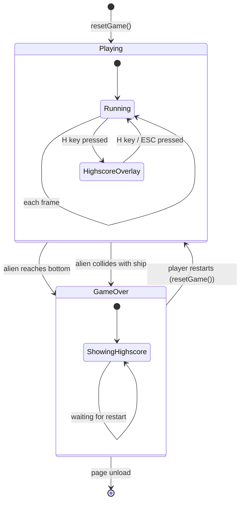

# ARC-004 Game State Machine

## Context

The game has two primary states: **Playing** and **GameOver**. Transitions are triggered by game-over conditions (alien reaches bottom, alien collides with ship) and by the player starting a new session. The state machine controls which systems run each frame and which UI is visible.

## Decision

A **simple two-state machine** implemented as a string variable `gameState` with values `'playing'` | `'gameover'`.

- **Playing state**:
  - Game loop runs: input → update → collision → render
  - Alien formation moves and descends
  - Player ship responds to input
  - Projectiles fire and move
  - Collision detection active
  - Score increments on alien destruction
  - Highscore overlay accessible via 'H' key
- **GameOver state**:
  - Game loop stops updating entities (no movement, no spawning)
  - Render shows final frame + game-over text + highscore list
  - Input only accepts new-session trigger (e.g., Enter/Space to restart)
  - Session highscore list displayed automatically
- **Transition Playing → GameOver**: when any alien's y-position ≥ ship y-position OR alien bounding box intersects ship bounding box (UC-004).
- **Transition GameOver → Playing**: player presses restart key; `resetGame()` called which:
  - Clears all entities
  - Resets score to 0
  - Clears session highscore list (UC-006: reset on new session)
  - Re-initializes alien formation and ship position
  - Sets `gameState = 'playing'`

No pause state, no menu state, no level transition — YAGNI.

## Alternatives

- **Explicit state class hierarchy** (`PlayingState`, `GameOverState` with `enter()`, `update()`, `exit()`) — rejected: adds files and boilerplate for two states; violates YAGNI.
- **State machine library (e.g., `xstate`)** — rejected: external dependency for a 2-state machine; violates YAGNI.
- **Enum-like object with sub-states** (e.g., `playing: { wave: 1 }`) — rejected: no wave/level concept in SPEC.

## Consequences

- **Positive**: trivial to understand, zero dependencies, state checks are `if (gameState === 'playing')` — readable and fast.
- **Negative**: no hierarchical states, no entry/exit hooks — accepted; not needed.
- **Testability**: state transitions are pure functions `nextState(currentState, event)` — unit-testable without browser.
- **Extensibility**: adding a pause state would mean one more string value and one `if` branch; no structural change.

