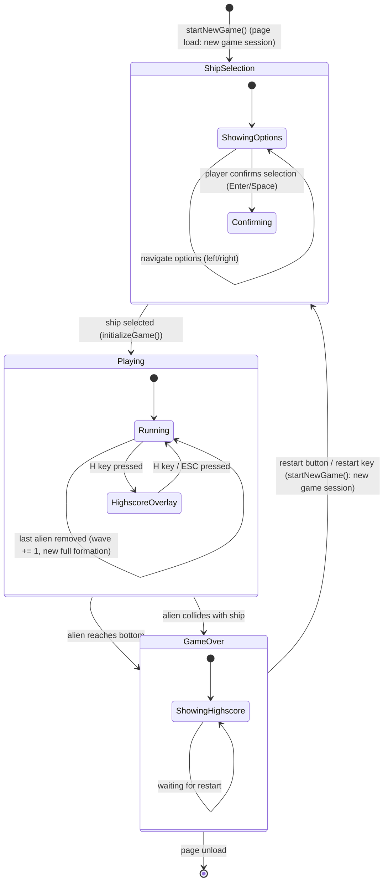

# ARC-004 Game State Machine

## Context

The game has three primary states: **ShipSelection**, **Playing**, and **GameOver**. Transitions are triggered by ship selection, game-over conditions (alien reaches bottom, alien collides with ship), and by the player starting a new session. The state machine controls which systems run each frame and which UI is visible. Within Playing, the game advances through waves (UC-009): a cleared formation starts the next wave instead of ending the game.

## Decision

A **simple three-state machine** implemented as a string variable `gameState` with values `'shipselection'` | `'playing'` | `'gameover'`.

- **ShipSelection state**:
  - Game loop renders the ship selection screen showing all available ship types
  - Player chooses between available ship types (regular or slow) using left/right navigation
  - Regular ship option shows: standard speed, standard projectile
  - Slow ship option shows: slower horizontal movement, special projectile destroying up to three aliens per shot
  - Player confirms selection (Enter/Space); `initializeGame(selectedShipType)` called which:
    - Sets up alien formation and ship position with the chosen ship type (regular or slow)
    - Configures ship movement speed and projectile behavior per type
    - Sets `gameState = 'playing'`
  - No game entities (aliens, projectiles) are active
  - Input only accepts ship selection navigation (left/right) and confirmation
  - Highscore overlay is not accessible

- **Playing state**:
  - Game loop runs: input → update → collision → render
  - Alien formation moves and descends
  - Player ship responds to input with type-specific movement speed
  - Projectiles fire and move with type-specific behavior (regular: single alien; slow: up to three aliens)
  - Collision detection active
  - A hit removes an alien only on its n‑th hit in wave n; the score increments when an alien is removed
  - When the last alien of the formation is removed, the next wave starts: `wave` increases by 1 and a new full formation is created in its start position, its aliens needing `wave` hits each (WAVE NEXT); score, ship and phase are unchanged
  - Highscore overlay accessible via 'H' key

- **GameOver state**:
  - Game loop stops updating entities (no movement, no spawning)
  - Render shows final frame + game-over text + highscore list
  - Input only accepts the new-session trigger: the restart button on the game-over screen, or Enter/Space once the initials are submitted
  - Session highscore list displayed automatically

- **Transition ShipSelection → Playing**: when player confirms a ship selection; `initializeGame(selectedShipType)` called which:
  - Sets up alien formation and ship position with the chosen ship type
  - Configures ship movement speed and projectile behavior per type
  - Sets `gameState = 'playing'`

- **Transition Playing → GameOver**: when any alien's y-position ≥ ship y-position OR alien bounding box intersects ship bounding box (UC-004).

- **Transition GameOver → ShipSelection**: player clicks the restart button (or presses the restart key); `startNewGame()` called, which starts a new game session in the state the page loads with — the constructor calls the same method (SESSION START STATE):
  - Regular ship at its start position, full alien formation, no projectiles
  - Resets score to 0
  - Sets `wave` to 1 (WAVE FIRST)
  - Keeps the session highscore list (SESSION HIGHSCORE KEPT ON NEW SESSION)
  - Sets phase to 'ShipSelection' (new game session)

The wave is a number held by `GameSession`, not a state of the machine: a new wave changes neither the allowed inputs nor the running systems, only the formation. No pause state, no menu state — YAGNI.

## Alternatives

- **Explicit state class hierarchy** (`ShipSelectionState`, `PlayingState`, `GameOverState` with `enter()`, `update()`, `exit()`) — rejected: adds files and boilerplate for three states; violates YAGNI.
- **State machine library (e.g., `xstate`)** — rejected: external dependency for a 3-state machine; violates YAGNI.
- **Enum-like object with sub-states** (e.g., `playing: { wave: 1 }`) or a separate `WaveTransition` state — rejected: a wave changes no input handling and no running system, so a state of its own adds transitions without behaviour; a counter is the simplest design (KISS).

## Consequences

- **Positive**: trivial to understand, zero dependencies, state checks are `if (gameState === 'playing')` — readable and fast.
- **Negative**: no hierarchical states, no entry/exit hooks — accepted; not needed.
- **Testability**: state transitions are pure functions `nextState(currentState, event)` — unit-testable without browser.
- **Extensibility**: adding a pause state would mean one more string value and one `if` branch; no structural change.

