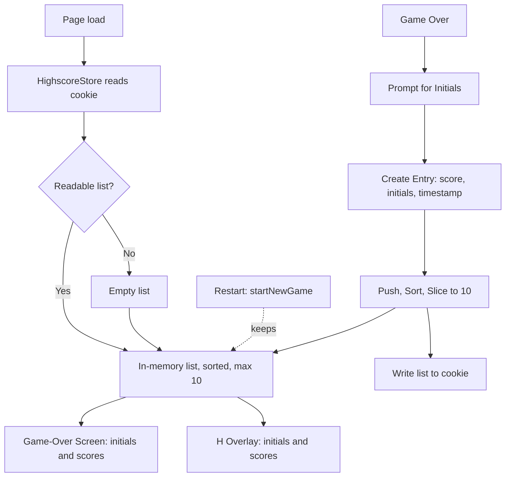

# ARC-005 Session Highscore Storage in a Browser Cookie

## Context

The game keeps a session highscore list of up to 10 entries, each with score, initials (up to 3 characters) and timestamp. The list is shown on the game-over screen and on demand during play, each entry with its initials and score. It keeps its entries when a new game session starts and when the page is reloaded in the same browser, and it is stored in the browser's cookies (UC-006). There is no server (IMPLEMENTATION JAVASCRIPT WEB), so the browser is the only place the list can outlive the page.

## Decision

The list is an **in-memory array mirrored to one browser cookie**, owned by `HighscoreStore` in MOD-game-logic. The cookie's name, value encoding and attributes are defined once, in MOD-game-logic.

- **Lifetime**: one `HighscoreStore` per page load, created with the `GameSession` when the page loads (game.js `start()`). `startNewGame()` does not touch it, so a new game session keeps the list (SESSION HIGHSCORE KEPT ON NEW SESSION).
- **Load**: the constructor reads the cookie once. No cookie, a value that does not parse, or a value that is not a list gives an empty list (UC-006 A4); entries without a numeric score and timestamp and a string of initials are dropped; the result is sorted and limited as on insertion.
- **Insertion** (on game over):
  1. Prompt for initials (default "AAA" if empty/cancelled — UC-006 A1).
  2. Create entry `{ score, initials, timestamp: Date.now() }`.
  3. Push to array.
  4. Sort: `score` descending, then `timestamp` ascending (UC-006 A2).
  5. Slice to max 10 entries.
  6. Write the whole list to the cookie (SESSION HIGHSCORE COOKIE STORAGE).
- **Access**: `getEntries()` returns a copy of the in-memory array; reading never touches the cookie.
- **Cookie access is passed in**: the constructor takes the object whose `cookie` property it reads and writes, `document` by default. Where there is no `document` (plain Node), the store keeps the list in memory only. Tests pass a stand-in object.
- **No clearing**: no operation empties the list.

## Alternatives

- **localStorage** — rejected: SESSION HIGHSCORE COOKIE STORAGE names cookies; it would also be a second storage medium to keep equal to the cookie (DRY).
- **Cookie plus localStorage fallback** — rejected: two copies of one list, and the requirement names cookies only.
- **IndexedDB** — rejected: asynchronous API for ≤10 small objects; not cookies.
- **Server-backed leaderboard** — rejected: no server in the architecture (IMPLEMENTATION JAVASCRIPT WEB); violates YAGNI.
- **One cookie per entry** — rejected: ten cookies to read, write and expire instead of one; the whole list is far below the 4 KB a cookie may hold.
- **Reading the cookie on every `getEntries()`** — rejected: the in-memory array is the list while the page lives; the cookie only has to survive the reload.

## Consequences

- **Positive**: zero dependencies, synchronous API, the list survives restarts and reloads, one place reads and one place writes the cookie.
- **Negative**: the list belongs to one browser and is lost when its cookies are cleared or expire — accepted, as the SPEC asks for the same browser only. The cookie is sent with every request to the page's origin — accepted, under 1 KB.
- **Open risk**: Chromium-based browsers are reported to keep no cookies for a page opened from a `file://` path; this was not verified for this product. If it holds, the list is kept across reloads only when the game is served over http(s); IMPLEMENTATION JAVASCRIPT WEB still holds, as the game is displayed in both cases.
- **Testability**: sorting, limit, load and write are tested in Node with a stand-in cookie object: a list written by one store is read back by a new store (reload), a new game session keeps the entries, and an unreadable cookie gives an empty list.
- **Extensibility**: a new entry field means extending the entry and the cookie value; entries without it are dropped on load.

