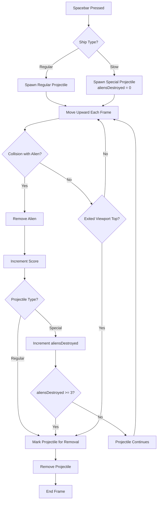

# ARC-006 Slow Ship Special Projectile Capability

## Context

The slow ship type (introduced in ARC-004 and UC-007/UC-008) requires a distinct projectile behavior: a **special projectile** that can destroy up to three aliens in a single shot before being removed. This differs from the regular ship's projectile, which destroys exactly one alien per shot (UC-003). The special projectile must:

- Be spawned when the player presses Spacebar while the slow ship is active
- Travel upward at constant speed (same as regular projectiles per PROJECTILE TRAVEL)
- Destroy up to three aliens sequentially on collision, continuing its trajectory after each hit
- Be removed after destroying the third alien or when exiting the viewport top
- Increment score by one for each alien destroyed (per SCORE INCREMENT)
- Coexist with regular projectiles in the same game session (only one ship type active at a time)

This decision refines ARC-001 (Overall Architecture) which establishes the module-based game loop with ProjectileManager and CollisionSystem in MOD-game-logic, and ARC-004 (Game State Machine) which defines the Playing state where projectiles fire and move with type-specific behavior.

## Decision

The special projectile is implemented as a **projectile variant with a hit counter** within the existing ProjectileManager and CollisionSystem of MOD-game-logic. No new module or architectural layer is introduced.

### Projectile representation

Each projectile in `ProjectileManager` carries a `type` field (`'regular' | 'special'`) and, for special projectiles, an `aliensDestroyed` counter (initially 0). The regular projectile has no counter (or counter fixed at 1).

```typescript
interface Projectile {
  x: number;
  y: number;
  speed: number;
  type: 'regular' | 'special';
  aliensDestroyed: number; // only used when type === 'special'
}
```

### Spawning

When `ProjectileManager.spawn(x, shipType)` is called:
- If `shipType === 'regular'`: create projectile with `type: 'regular'`, `aliensDestroyed: 0`
- If `shipType === 'slow'`: create projectile with `type: 'special'`, `aliensDestroyed: 0`

Only one projectile exists per Spacebar press (edge-triggered input per ARC-003).

### Movement

All projectiles move upward at the same constant speed each frame (per PROJECTILE TRAVEL). No difference in velocity between types.

### Collision handling

`CollisionSystem.checkProjectileAlien(projectiles, aliens)` returns collisions with the projectile and alien involved. The `GameSession` processes each collision:

1. Remove the alien from the formation
2. Increment score by 1 (per SCORE INCREMENT)
3. If projectile `type === 'special'`:
   a. Increment `aliensDestroyed`
   b. If `aliensDestroyed >= 3`: mark projectile for removal
   c. Else: projectile continues upward (remains active)
4. If projectile `type === 'regular'`: mark projectile for removal immediately

### Removal conditions

A projectile is removed when:
- It exits the viewport top (per PROJECTILE REMOVAL)
- It is a regular projectile and has collided with an alien
- It is a special projectile and `aliensDestroyed >= 3`

### Rendering

`CanvasRenderer.drawProjectiles(positions)` receives projectiles with type information and renders them identically (small rectangles). Visual distinction is not required by the SPEC; the behavioral difference is the architectural concern.

## Alternatives

- **Separate ProjectileManager for special projectiles** — rejected: duplicates movement, removal, and spawning logic; violates DRY and YAGNI NO UNNECESSARY ABSTRACTION. The only difference is the hit counter and removal condition.
- **Separate collision system for special projectiles** — rejected: same reasoning; collision detection (bounding-box intersection) is identical, only post-collision behavior differs.
- **Special projectile as a new entity type with its own module** — rejected: adds a file and module boundary for a 20-line behavioral variation; violates KISS NO EXTRA FEATURES and YAGNI.
- **Regular projectile that splits into three on first hit** — rejected: more complex (spawning new entities mid-frame); the hit-counter approach is simpler and matches UC-008's sequential destruction flow.
- **Piercing projectile (destroys all aliens in path)** — rejected: violates PLAYER SHIP SLOW SPECIAL SHOT which caps at three aliens.

## Consequences

- **Positive**: minimal code change (one counter field, one conditional branch in collision handling); reuses all existing projectile infrastructure (movement, spawning, removal, rendering); zero new files or modules; fully testable via existing unit test points (ProjectileManager, CollisionSystem).
- **Negative**: `Projectile` interface carries a field (`aliensDestroyed`) only used by one variant — accepted as a trivial cost compared to duplication; special projectile removal logic is slightly more complex than regular — accepted as the simplest correct implementation.
- **Testability**: existing test battery for projectile behavior (UC-003, PROJECTILE TRAVEL, PROJECTILE REMOVAL, ALIEN DESTRUCTION, SCORE INCREMENT) extends with two new cases: special projectile destroys 1, 2, or 3 aliens before removal; special projectile misses all aliens and exits viewport.
- **Extensibility**: adding a third ship type with a different projectile behavior (e.g., 5-hit, or exploding radius) would follow the same pattern: extend `type` enum, add variant-specific counter/logic in collision handler.

