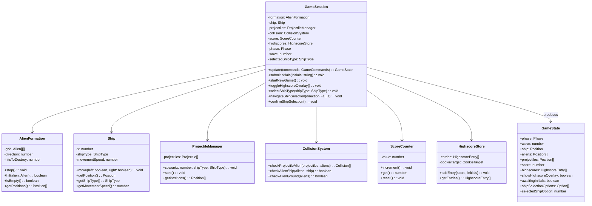

# MOD-game-logic Game Logic Module

## Responsibility

Own all mutable game state and simulate the game rules each frame. This includes: alien formation movement and descent, alien hits and waves, projectile physics, collision detection, scoring, game-over detection, and session highscore management, including the highscore cookie. The module is pure simulation — it knows nothing about input devices or rendering.

## Parts

- `GameSession` — Orchestrates the game loop: receives `GameCommands`, updates simulation, produces `GameState`. Manages game phases (ShipSelection, Playing, GameOver) and the current wave (ARC-004). Handles ship type selection and initialization.
- `AlienFormation` — Stores alien grid positions, moves horizontally, reverses at edges, descends. **Counts the hits each alien has received and removes an alien on the hit that reaches the formation's `hitsToDestroy` (the wave number).**
- `Ship` — Stores ship horizontal position, clamps to screen bounds, **holds ship type (regular/slow) with type-specific movement speed**.
- `ProjectileManager` — Spawns, moves, and removes projectiles; detects collisions with aliens. **Supports two projectile types: regular (hits one alien) and special slow-ship projectile (hits up to three aliens per shot, ARC-006)**.
- `CollisionSystem` — Detects projectile-alien and alien-ship/ground collisions. **Handles multi-hit special projectile collisions**.
- `ScoreCounter` — Tracks current score; increments on alien destruction.
- `HighscoreStore` — Manages the session highscore list (max 10 entries, sorted by score desc, timestamp asc tie-break); loads it from the highscore cookie when created and writes it there after every insertion (ARC-005); never empties it.
- `GameState` — Immutable snapshot exposed to Rendering Layer each frame.

## Data

- `AlienFormation`: 2D array of aliens (x, y, hits received), formation direction (+1/-1), speed, descent step, `hitsToDestroy`.
- `Ship`: x position (clamped to screen width), width, **shipType ('regular' | 'slow'), movementSpeed (type-dependent)**.
- `ProjectileManager`: array of active projectiles (x, y, speed, **type: 'regular' | 'special', aliensHit: number** for special projectiles).
- `ScoreCounter`: integer score.
- `HighscoreStore`: array of `{ score: number, initials: string, timestamp: number }`, max length 10.
- `GameSession`: current phase (ShipSelection | Playing | GameOver), current `wave` (1 at the start of every game session), final score of last game, awaiting initials flag, **selectedShipType**.
- **Highscore cookie** (owned here, the only format that leaves the module): name `alieninvasion_highscores`; value `encodeURIComponent(JSON.stringify(entries))`, where `entries` is the list as `Array<{ score: number; initials: string; timestamp: number }>`; attributes `max-age=34560000` (400 days, renewed on every write), `path=/`, `SameSite=Lax`. Ten entries take well under 1 KB.

## Interfaces

- `GameState` — Immutable snapshot exposed to the Rendering Layer each frame. Contains the current phase (`ShipSelection`, `Playing`, `GameOver`), the current wave, ship state (position, type, speed), alien positions, projectiles, score, highscore entries, overlay visibility flags, and ship selection options with the currently highlighted option.

```typescript
interface GameState {
  phase: 'ShipSelection' | 'Playing' | 'GameOver';
  wave: number; // 1 at the start of every game session
  ship: { x: number; width: number; shipType: 'regular' | 'slow'; movementSpeed: number };
  aliens: Array<{ x: number; y: number; width: number; height: number }>;
  projectiles: Array<{ x: number; y: number; type: 'regular' | 'special'; aliensHit: number }>;
  score: number;
  highscores: Array<{ score: number; initials: string; timestamp: number }>;
  showHighscoreOverlay: boolean;
  awaitingInitials: boolean;
  shipSelectionOptions?: Array<{ type: 'regular' | 'slow'; label: string; description: string }>;
  selectedShipOption?: number;
}
```

- `HighscoreList` — Manages the session highscore list (max 10 entries, sorted by score descending, timestamp ascending for ties). Created with the object whose `cookie` property holds the highscore cookie (`document` by default; without one the list is kept in memory only); loads the list from it, giving an empty list when the cookie is missing or unreadable. Provides `addEntry(score, initials)` to insert a new entry and write the list to the cookie, and `getEntries()` to retrieve a copy of the list. Neither throws.

```typescript
interface HighscoreList {
  constructor(cookieTarget?: { cookie: string }): HighscoreList;
  entries: Array<{ score: number; initials: string; timestamp: number }>;
  addEntry(score: number, initials: string): void;
  getEntries(): Array<{ score: number; initials: string; timestamp: number }>;
}
```

- `GameSession` — Orchestrates the game loop: receives `GameCommands`, updates simulation, and produces `GameState`. Manages game phases and ship type selection. Provides `update(commands)`, `submitInitials(initials)`, `startNewGame()`, `toggleHighscoreOverlay()`, `selectShipType(shipType)`, `navigateShipSelection(direction)`, and `confirmShipSelection()`.

```typescript
interface GameSession {
  update(commands: GameCommands): GameState;
  submitInitials(initials: string): void;
  startNewGame(): void;
  toggleHighscoreOverlay(): void;
  selectShipType(shipType: 'regular' | 'slow'): void;
  navigateShipSelection(direction: -1 | 1): void;
  confirmShipSelection(): void;
}
```

The Input Layer calls `update(commands)` each frame. The Rendering Layer calls `getState(): GameState` each frame. Highscore overlay toggle and initials submission are triggered by UI events forwarded from Rendering. Ship selection navigation and confirmation are handled via `navigateShipSelection`, `confirmShipSelection`, and `selectShipType`.

## Files

- `src/game-logic/GameSession.ts` — Main orchestrator, game loop step, ship selection handling.
- `src/game-logic/AlienFormation.ts` — Formation movement, edge reversal, descent.
- `src/game-logic/Ship.ts` — Ship position, clamping, **ship type and type-specific movement speed**.
- `src/game-logic/ProjectileManager.ts` — Projectile spawning, movement, removal, **special projectile multi-hit logic**.
- `src/game-logic/CollisionSystem.ts` — Bounding-box collision checks, **special projectile handling (up to 3 aliens)**.
- `src/game-logic/ScoreCounter.ts` — Score tracking.
- `src/game-logic/HighscoreStore.ts` — Session highscore list management; reads and writes the highscore cookie.
- `src/game-logic/GameState.ts` — Snapshot type definition.
- `src/game-logic/index.ts` — Public export barrel.

## Uses

- `MOD-input.GameCommands` from MOD-input.

