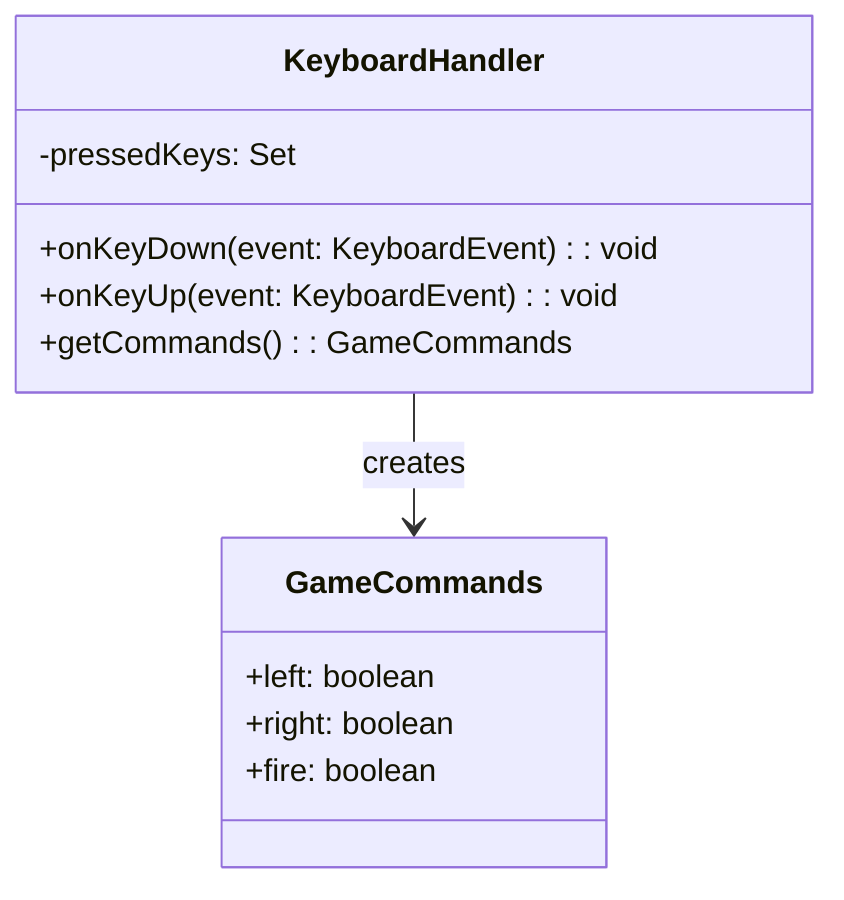

# MOD-input Input Module

## Responsibility

Translate raw keyboard events into canonical game commands for the Game Logic Layer. This module owns no game state; it only maps input to intent.

## Parts

- `KeyboardHandler` — Registers keydown/keyup listeners, tracks key state, emits `GameCommands` objects.
- `GameCommands` — Immutable data structure representing the player's intent for a single frame: `{ left: boolean, right: boolean, fire: boolean }`.

## Data

- Current key state: Set of pressed keys (ArrowLeft, ArrowRight, KeyA, KeyD, Space).
- No persistent data; state resets each frame after emitting commands.

## Interfaces

- **GameCommands**

```typescript
interface GameCommands {
  left: boolean;   // true when ArrowLeft or KeyA held
  right: boolean;  // true when ArrowRight or KeyD held
  fire: boolean;   // true on Space keydown (not hold)
}
```

The Game Logic Layer calls `getCommands(): GameCommands` each frame to retrieve the current intent.

## Files

- `src/input/KeyboardHandler.ts` — Implements event listeners, key-state tracking, and `getCommands()`.
- `src/input/GameCommands.ts` — Type definition for the `GameCommands` interface.
- `src/input/index.ts` — Public export barrel.

## Uses

- None (this is the bottom layer; it uses only browser DOM APIs).

