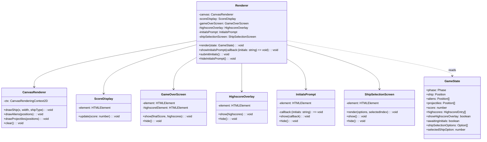

# MOD-rendering Rendering Module

## Responsibility

Draw the current `GameState` to an HTML `<canvas>` and manage DOM overlays for score, game-over screen, highscore list, and ship selection screen. This module is purely presentational — it holds no game logic and mutates no simulation state.

## Parts

- `CanvasRenderer` — Draws ship, aliens, projectiles to canvas each frame. **Renders ship with type-appropriate visuals (regular vs slow).**
- `ScoreDisplay` — Updates a DOM element with the current score.
- `GameOverScreen` — Shows/hides the game-over overlay with final score and highscore list.
- `HighscoreOverlay` — Shows/hides the in-game highscore list overlay (triggered by 'H' key).
- `InitialsPrompt` — Prompts for player initials when a new highscore qualifies.
- `ShipSelectionScreen` — **Renders the ship selection UI showing available ship types with their characteristics, highlights the currently selected option.**
- `Renderer` — Facade coordinating all drawing and overlay management.

## Data

- Canvas context (2D).
- DOM element references: score element, game-over overlay, highscore overlay, initials input, **ship selection overlay**.
- No simulation state; reads only from `GameState` snapshot.

## Interfaces

- `Renderer` — Facade coordinating all drawing and overlay management.

```typescript
interface Renderer {
  render(state: GameState): void;
  showInitialsPrompt(callback: (initials: string) => void): void;
  submitInitials(): void;
  hideInitialsPrompt(): void;
}
```

The Game Logic Layer (via the main entry point) calls `render(state)` each frame. When `GameState.awaitingInitials` is true, the entry point calls `showInitialsPrompt` with a callback that forwards initials to `GameSession.submitInitials()`. **When `GameState.phase === 'ShipSelection'`, the `ShipSelectionScreen` renders the selection UI using `shipSelectionOptions` and `selectedShipOption`.**

## Files

- `src/rendering/CanvasRenderer.ts` — Canvas drawing operations for all entities, **ship type-specific rendering**.
- `src/rendering/ScoreDisplay.ts` — DOM score element updates.
- `src/rendering/GameOverScreen.ts` — Game-over overlay DOM management.
- `src/rendering/HighscoreOverlay.ts` — In-game highscore list overlay DOM management.
- `src/rendering/InitialsPrompt.ts` — Initials input dialog.
- `src/rendering/ShipSelectionScreen.ts` — **Ship selection UI rendering (options, highlights, descriptions).**
- `src/rendering/Renderer.ts` — Facade coordinating all renderers.
- `src/rendering/index.ts` — Public export barrel.

## Uses

- `MOD-game-logic.GameState` from MOD-game-logic.

