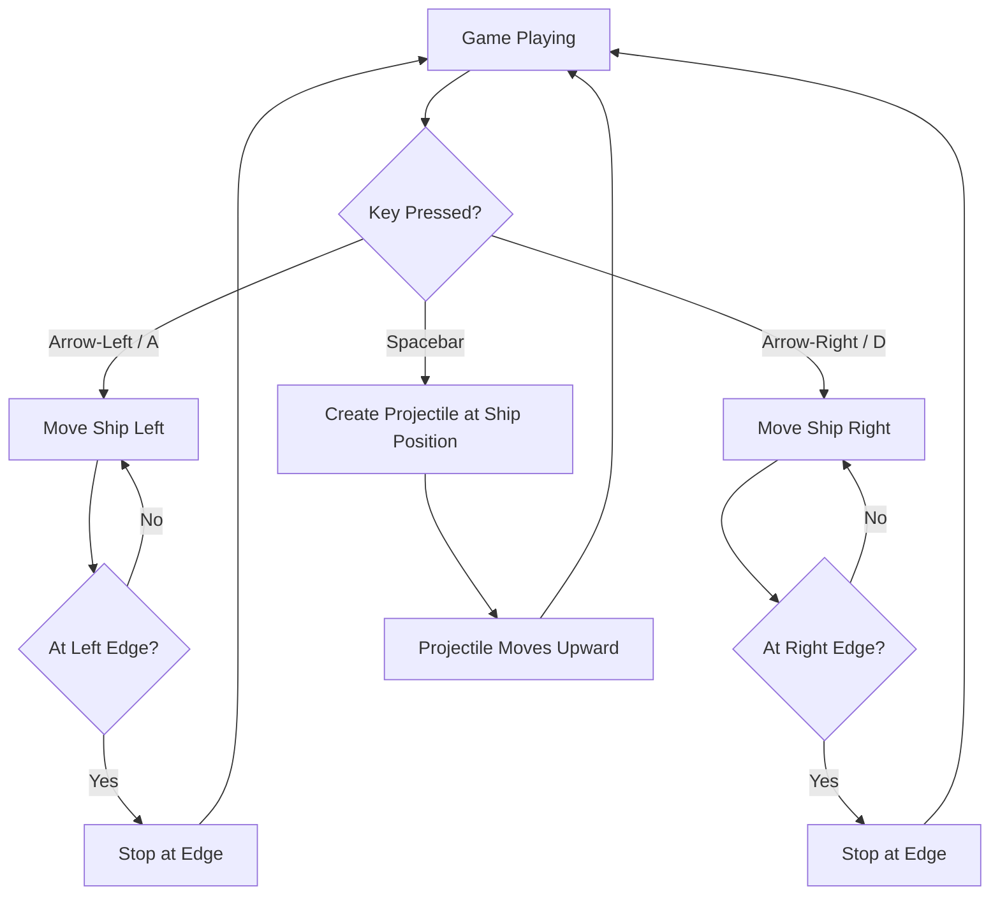

# UC-001 Player Controls Ship

## Actors

- Player

## Precondition

- Game is in the playing state.
- Player's ship is rendered at the bottom centre of the screen.

## Main flow

1. Player presses Arrow‑Left or A key.
2. Ship moves left at constant speed while the key is held.
3. Ship stops at the left screen edge and does not move further left.
4. Player releases the key; ship stops.
5. Player presses Arrow‑Right or D key.
6. Ship moves right at constant speed while the key is held.
7. Ship stops at the right screen edge and does not move further right.
8. Player releases the key; ship stops.
9. Player presses Spacebar.
10. A projectile entity is created at the ship's current position and begins moving upward.
11. Only one projectile exists per key press; holding Spacebar does not create a stream.

## Alternative flows

- **A1: Simultaneous key presses** — If both left and right keys are held, the ship does not move (inputs cancel).
- **A2: Fire while moving** — Firing does not interrupt horizontal movement; the projectile spawns at the ship's current position.
- **A3: Key release at edge** — If the player releases the movement key exactly at the screen edge, the ship remains at the edge.

## Postcondition

- Ship horizontal position reflects the net left/right input and stays within screen bounds.
- A projectile exists and moves upward from the ship's position at the moment of firing.

