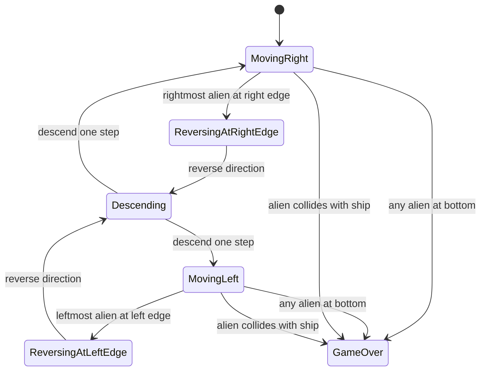

# UC-002 Aliens Invade

## Actors

- System (autonomous alien formation)

## Precondition

- Game is in the playing state.
- A formation of alien rows is rendered at the top portion of the screen.

## Main flow

1. The alien formation moves horizontally as a single unit at constant speed.
2. When the rightmost alien reaches the right screen edge, the formation reverses direction.
3. The formation descends one step downward.
4. The formation now moves horizontally in the opposite direction.
5. When the leftmost alien reaches the left screen edge, the formation reverses direction again.
6. The formation descends one step downward.
7. The horizontal movement and descent cycle repeats continuously while the game is in the playing state.

## Alternative flows

- **A1: Formation reaches bottom** — If any alien reaches the bottom of the screen, the game transitions to the Game‑Over state (see UC-004).
- **A2: Formation collides with ship** — If any alien collides with the player's ship, the game transitions to the Game‑Over state (see UC-004).

## Postcondition

- Alien formation position has updated: horizontally moved, reversed at edges, and descended after each reversal.
- Formation remains a coherent grid; no alien overlaps screen boundaries horizontally.

