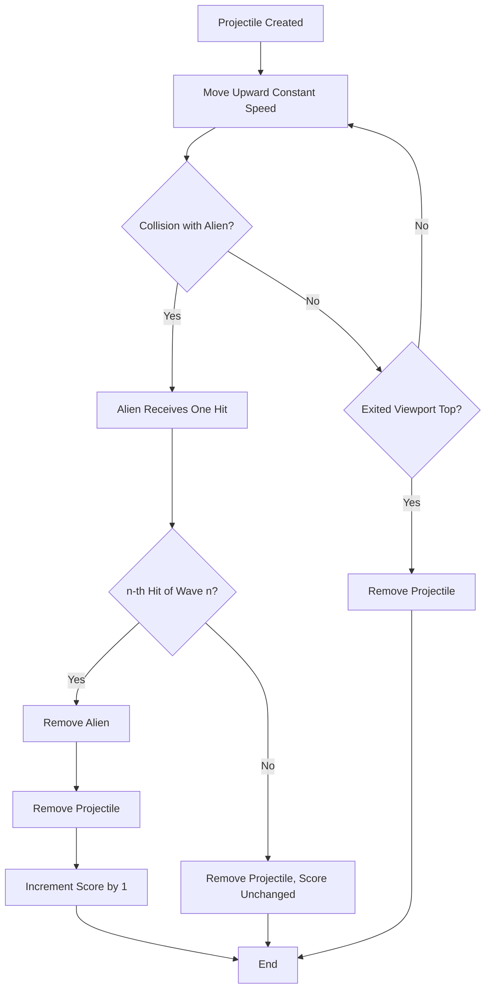

# UC-003 Projectile Flies and Hits

## Actors

- System (projectile and alien entities)

## Precondition

- Game is in the playing state.
- A projectile entity exists at the player's ship position, created by UC-001's Main flow step where the projectile is spawned.
- Alien formation exists (UC-002); its aliens belong to the current wave n (UC-009).

## Main flow

1. Projectile moves upward at constant speed each frame.
2. Projectile's y‑position decreases steadily until one of the removal conditions occurs.
3. **Collision with alien**: Projectile's bounding box intersects an alien's bounding box; the alien receives one hit.
4. The alien has now received n hits, n being the number of the current wave: the alien entity is removed from the game area.
5. Projectile entity is removed.
6. Player's score increments by exactly one point.
7. **Exit viewport**: Projectile's y‑position moves above the top of the viewport.
8. Projectile entity is removed.

## Alternative flows

- **A1: Multiple aliens in path** — Only the first alien intersected receives the hit; the projectile is removed at that point.
- **A2: Projectile misses all aliens** — Projectile continues upward until it exits the viewport and is removed (the viewport exit removal steps).
- **A3: Hit leaves the alien in place** — The alien has now received fewer than n hits (possible from wave 2 on): the alien stays in the game area and keeps the count of hits it has received; the projectile entity is removed; the score is unchanged.

## Postcondition

- If a collision removed the alien: one alien removed, one projectile removed, score increased by one.
- If a collision left the alien in place: the alien has received one more hit, one projectile removed, score unchanged.
- If no collision: projectile removed at viewport top, score unchanged.
- No projectile exists outside the viewport.

