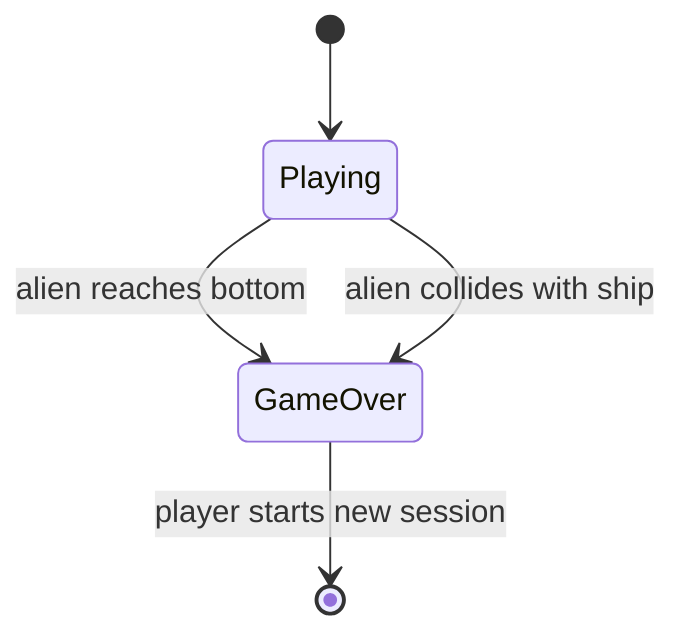

# UC-004 Game Ends

## Actors

- System
- Player

## Precondition

- Game is in the playing state.
- Alien formation exists (UC-002).
- Player's ship exists (UC-001).

## Main flow

1. System detects that any alien has reached the bottom of the screen (y‑position ≥ ship's y‑position).
2. System switches game state to Game‑Over.
3. All entity spawning stops.
4. Game‑Over screen is displayed.
5. Session highscore list is shown (see UC-006).

## Alternative flows

- **A1: Alien collides with ship** — System detects bounding-box intersection between any alien and the player's ship.
  - Game state switches to Game‑Over (the game state switch step).
  - All entity spawning stops (the spawning stop step).
  - Game‑Over screen displayed (the game-over screen display step).
  - Session highscore list shown (the highscore list display step).

## Postcondition

- Game state is Game‑Over.
- No new aliens, projectiles, or other entities are spawned.
- Game‑Over screen with session highscore list is visible.

