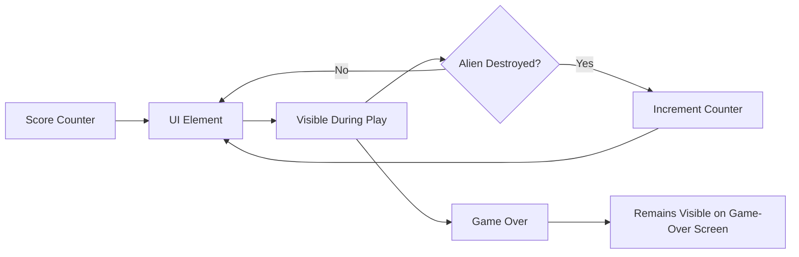

# UC-005 Score Shown

## Actors

- Player

## Precondition

- Game is in the playing state.
- Score counter exists and is initialized to zero.

## Main flow

1. A dedicated UI element displays the current score at a prominent screen location (e.g., top‑left or top‑right).
2. The displayed value updates immediately after each alien destruction (UC-003's Main flow step where score increments).
3. The score remains visible throughout the playing state.

## Alternative flows

- **A1: Game‑Over state** — The score display remains visible on the Game‑Over screen alongside the highscore list (UC-006).

## Postcondition

- Current score is always visible and numerically accurate during gameplay.

