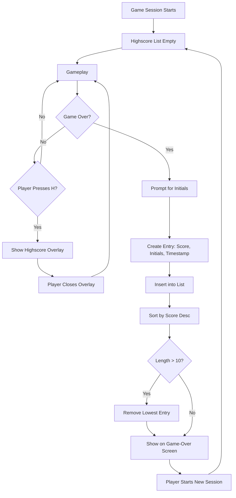

# UC-006 Session Highscores Managed

## Actors

- Player
- System

## Precondition

- A game session exists (starts when the player launches the game or starts a new game after Game‑Over).
- Highscore store is empty at session start.

## Main flow

1. **Entry creation**: When the game ends (UC-004), the system prompts the player for up to three initials.
2. Player enters initials (1–3 characters).
3. System creates a highscore entry with: final score, entered initials, current timestamp.
4. Entry is inserted into the session highscore list.
5. List is sorted by score descending.
6. If list length exceeds ten, the lowest‑scoring entry is removed.
7. **Display on Game‑Over**: The highscore list is shown on the Game‑Over screen (UC-004's Main flow step where highscore list is shown).
8. **Access during gameplay**: Player presses a designated key (e.g., 'H') to open the highscore list.
9. List is displayed as an overlay; pressing the key again or ESC closes it.
10. **Session reset**: When the player starts a new game session, the highscore list is cleared to empty.

## Alternative flows

- **A1: Player skips initials** — If the player cancels or submits empty initials, the entry uses "AAA" as default.
- **A2: Tie scores** — Entries with equal score are ordered by timestamp ascending (earlier achievement ranks higher).
- **A3: Highscore key pressed on Game‑Over screen** — The list is already visible; the key has no additional effect.

## Postcondition

- Session highscore list contains at most ten entries, each with score, initials, timestamp.
- List is sorted by score descending (ties by timestamp ascending).
- List is visible on Game‑Over screen and accessible on demand during gameplay.
- Starting a new session clears the list.

