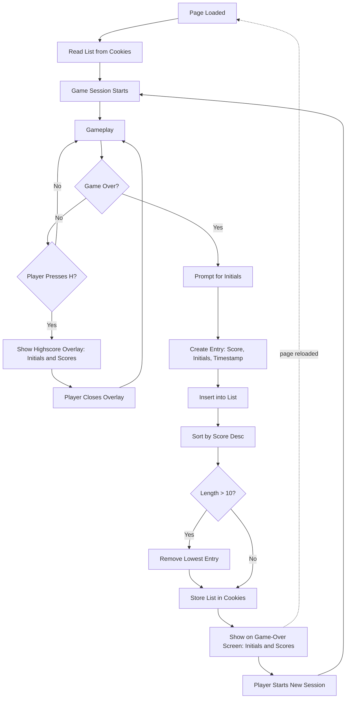

# UC-006 Session Highscores Managed

## Actors

- Player
- System

## Precondition

- The page has been loaded in the browser; the system has read the highscore list stored in the browser's cookies.
- A game session exists (starts when the player launches the game or starts a new game after Game‑Over).

## Main flow

1. **Entry creation**: When the game ends (UC-004), the system prompts the player for up to three initials.
2. Player enters initials (1–3 characters).
3. System creates a highscore entry with: final score, entered initials, current timestamp.
4. Entry is inserted into the session highscore list.
5. List is sorted by score descending.
6. If list length exceeds ten, the lowest‑scoring entry is removed.
7. System stores the list, with each entry's score, initials and timestamp, in the browser's cookies.
8. **Display on Game‑Over**: The highscore list is shown on the Game‑Over screen (UC-004's Main flow step where highscore list is shown), each entry with its initials and score.
9. **Access during gameplay**: Player presses a designated key (e.g., 'H') to open the highscore list.
10. List is displayed as an overlay, each entry with its initials and score; pressing the key again or ESC closes it.
11. **New session**: When the player starts a new game session, the highscore list keeps its entries.
12. **Reload**: When the player reloads the page in the same browser, the system reads the list back from the browser's cookies, and the list holds the same entries as before the reload.

## Alternative flows

- **A1: Player skips initials** — If the player cancels or submits empty initials, the entry uses "AAA" as default.
- **A2: Tie scores** — Entries with equal score are ordered by timestamp ascending (earlier achievement ranks higher).
- **A3: Highscore key pressed on Game‑Over screen** — The list is already visible; the key has no additional effect.
- **A4: No stored list** — On the first visit, or when the browser holds no cookie with a highscore list of the game, the list starts empty.

## Postcondition

- Session highscore list contains at most ten entries, each with score, initials, timestamp.
- List is sorted by score descending (ties by timestamp ascending).
- List is stored in the browser's cookies.
- List is visible on Game‑Over screen and accessible on demand during gameplay, showing every entry's initials and score.
- Starting a new session or reloading the page keeps the list's entries.

