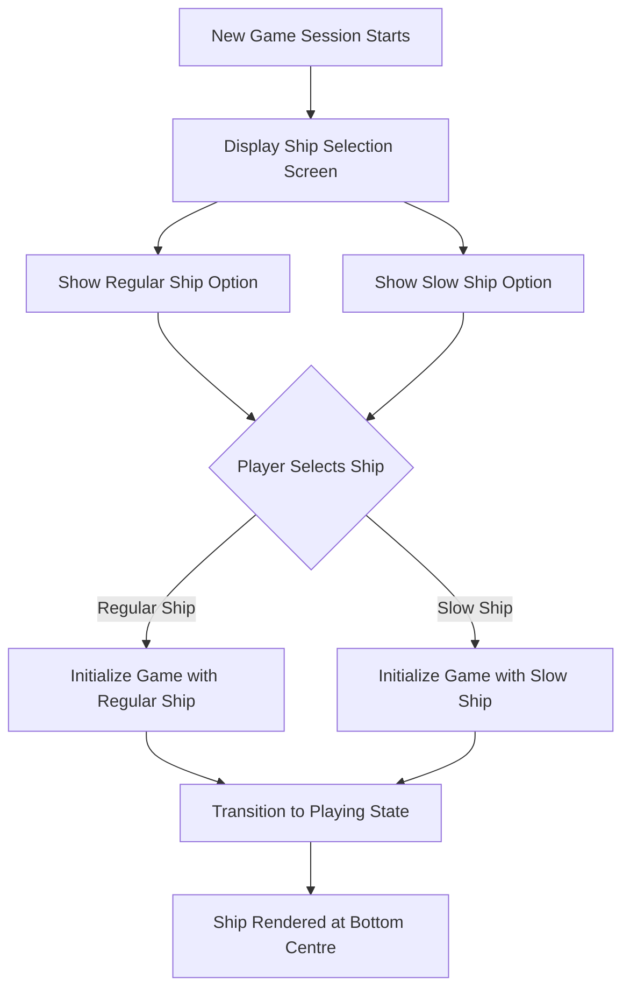

# UC-007 Ship Selection

## Actors

- Player

## Precondition

- Game is launched and a new game session is starting.
- No ship has been selected yet.

## Main flow

1. System displays the ship selection screen with all available ship types.
2. The regular ship is shown as a selectable option with its characteristics (standard speed, standard projectile).
3. The slow ship is shown as a selectable option with its characteristics (slower horizontal movement, special projectile that destroys up to three aliens per shot).
4. Player selects one of the available ship types.
5. System confirms the selection and initializes the game session with the chosen ship type.
6. Game transitions to the playing state with the selected ship rendered at the bottom centre of the screen.

## Alternative flows

- **A1: Player attempts to start without selection** — The start action is disabled until a ship type is selected.
- **A2: Player changes selection** — Player may switch between ship types before confirming; the display updates to reflect the currently highlighted option.

## Postcondition

- A ship type has been selected (regular or slow).
- Game is in the playing state with the chosen ship type active.
- The selected ship's movement speed and projectile behavior correspond to its type.

