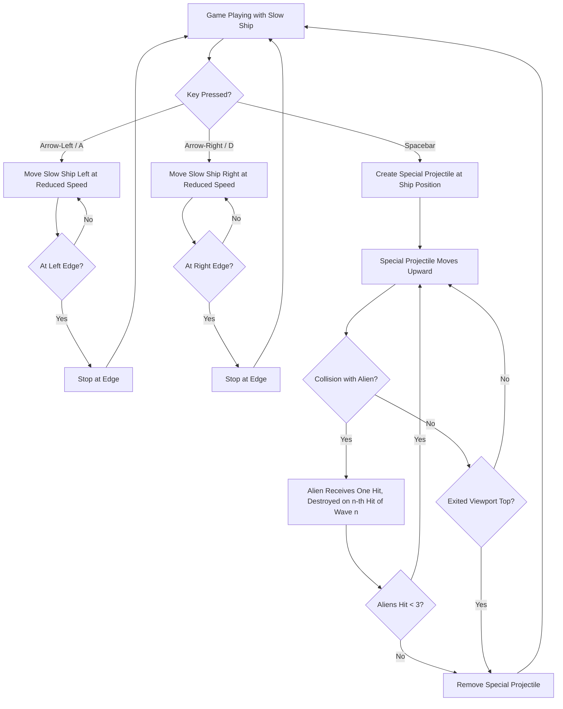

# UC-008 Slow Ship Controls

## Actors

- Player

## Precondition

- Game is in the playing state.
- Slow ship has been selected (UC-007).
- Slow ship is rendered at the bottom centre of the screen.

## Main flow

1. Player presses Arrow‑Left or A key.
2. Slow ship moves left at a slower constant speed than the regular ship while the key is held.
3. Slow ship stops at the left screen edge and does not move further left.
4. Player releases the key; slow ship stops.
5. Player presses Arrow‑Right or D key.
6. Slow ship moves right at a slower constant speed than the regular ship while the key is held.
7. Slow ship stops at the right screen edge and does not move further right.
8. Player releases the key; slow ship stops.
9. Player presses Spacebar.
10. A special projectile entity is created at the slow ship's current position and begins moving upward.
11. Only one special projectile exists per key press; holding Spacebar does not create a stream.
12. Special projectile moves upward and can destroy up to three aliens in a single shot before being removed.

## Alternative flows

- **A1: Simultaneous key presses** — If both left and right keys are held, the slow ship does not move (inputs cancel).
- **A2: Fire while moving** — Firing does not interrupt horizontal movement; the special projectile spawns at the slow ship's current position.
- **A3: Key release at edge** — If the player releases the movement key exactly at the screen edge, the slow ship remains at the edge.
- **A4: Special projectile hits multiple aliens** — The special projectile intersects up to three aliens sequentially; each intersected alien receives one hit and is destroyed when that hit is its n‑th in wave n (UC-003); the projectile continues until it has hit the third alien or exits the viewport.
- **A5: Special projectile misses all aliens** — Special projectile continues upward until it exits the viewport and is removed.

## Postcondition

- Slow ship horizontal position reflects the net left/right input and stays within screen bounds.
- Slow ship moves at a slower horizontal speed than the regular ship.
- A special projectile exists and moves upward from the slow ship's position at the moment of firing.
- Special projectile hits up to three aliens, and so destroys up to three, before being removed.

