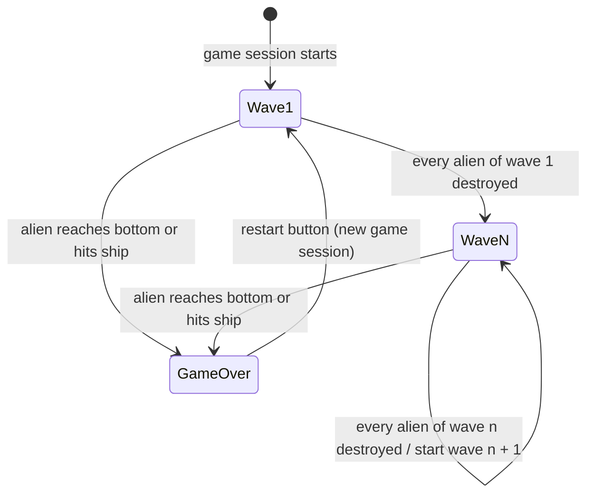

# UC-009 Waves Advance

## Actors

- System (alien formation and game session)

## Precondition

- A game session has started and the player has selected a ship (UC-007).

## Main flow

1. The game session begins with wave 1; the alien formation is in its start position, and each of its aliens is removed by its first hit (UC-003).
2. The formation moves and descends (UC-002) while the player shoots at it (UC-001, UC-008).
3. The player destroys every alien of the current wave n.
4. The next wave n + 1 starts: a full alien formation appears in its start position, and each of its aliens is removed by its (n + 1)‑th hit (UC-003).
5. The score and the player's ship are kept; the game stays in the playing state.
6. Steps 2–5 repeat for every following wave until the game ends (UC-004).

## Alternative flows

- **A1: Game ends during a wave** — An alien reaches the bottom of the screen or collides with the player's ship; the game switches to the Game‑Over state (UC-004), whatever the wave.
- **A2: New game session** — The player starts a new game session with the restart button (UC-004); the new session begins with wave 1 (step 1), whatever wave the previous session reached.

## Postcondition

- While the game is in the playing state, there is exactly one current wave n ≥ 1, and each alien of its formation is removed by its n‑th hit.
- Destroying every alien of a wave never ends the game; it starts the next wave.
- Every game session has begun with wave 1.

